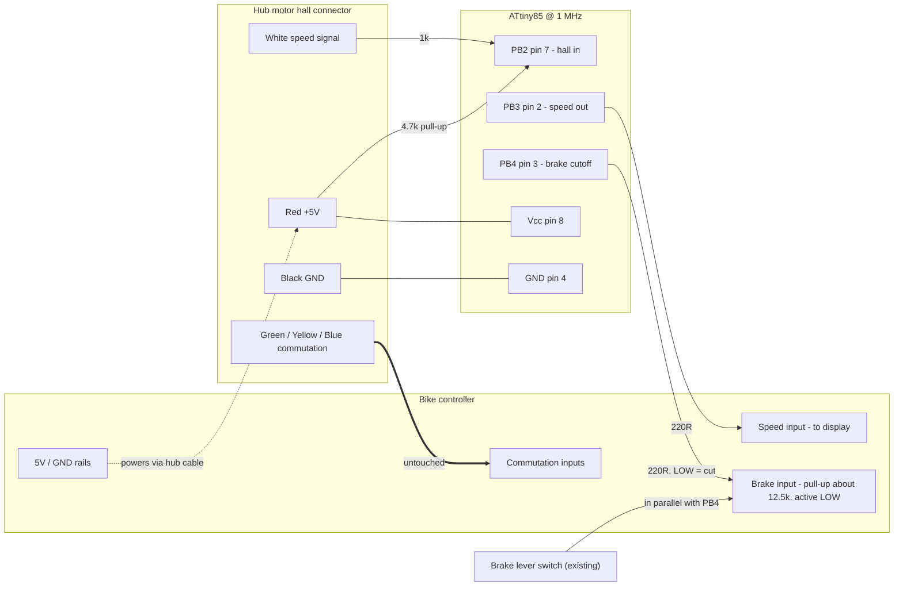
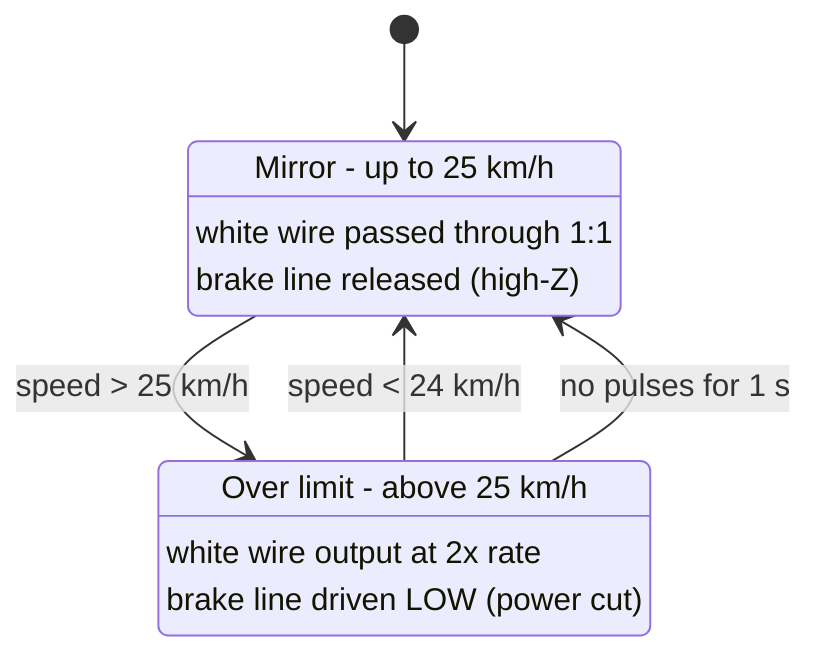

# Bikespeed circuit design

An ATtiny85 sits between a hub motor and its controller. It does two jobs:

1. **Display spoof.** It reads the motor's white speed wire and passes it on to the controller. Below 25 km/h it mirrors the pulses 1:1. Above 25 km/h it outputs them at 2× the rate, so the bike display shows about double the real speed.
2. **Power cutoff.** Above 25 km/h it pulls the controller's brake-cutoff line LOW, which cuts motor power. It releases below 24 km/h.

The spoof alone did not limit the bike. The controller works out its own speed from the commutation halls (green, yellow, blue), so it ignores the doubled white wire. The brake-cutoff line is what actually stops the motor.

Firmware: [hubspeed/hubspeed.ino](hubspeed/hubspeed.ino)

## Circuit diagram

## Breadboard layout

Build notes for the breadboard:

- The ATtiny85 straddles the centre gap with the notch on the left. Pins 1–4 are on the bottom row (f) in columns 10–13, and pins 5–8 are on the top row (e), with pin 8 over column 10.
- Top rails: + (red) and − (blue). The 100 nF and 10 µF capacitors sit directly across them, close to the chip. The 10 µF electrolytic has its + leg in the + rail.
- The bottom − rail is joined to the top − rail by the blue jumper down the left edge, so there is one common ground.
- Pin 4 (GND) goes to the bottom − rail with a short blue jumper.
- Power comes in on the motor red and black leads (the controller's own 5 V and GND).
- The brake lever stays connected as it is. The two brake sensor wires, red (reads 5 V) and black (GND), are spliced in: red goes to the 220 Ω resistor on PB4 and black goes to the ground rail.

## Block diagram

## Connections

| ATtiny85 pin | Name | Connects to | Via |
|---|---|---|---|
| 1 | PB5 / RESET | not connected | |
| 2 | PB3 | Controller side of the white wire (output) | 220 Ω |
| 3 | PB4 | Brake sensor wire that reads 5 V (red), spliced in parallel with the existing lever switch | 220 Ω |
| 4 | GND | Hub connector black, brake sensor black | |
| 5, 6 | PB0, PB1 | not connected | |
| 7 | PB2 | Motor side of the white wire (input) | 1 kΩ, plus 4.7 kΩ pull-up to +5 V |
| 8 | Vcc | Hub connector red (+5 V) | 100 nF and 10 µF to GND at the chip |

The green, yellow and blue commutation wires are not touched. Interfering with them can make the motor stutter or damage the controller.

## Signal behaviour

- The 1 km/h hysteresis stops the output chattering around the threshold.
- Speed is calculated from the pulse period: 6 pulses per wheel revolution and a 29" wheel (circumference about 2.314 m).
- With the cutoff active the bike coasts below 24 km/h and power comes back. The result is a pulsing cap at about 24–25 km/h.

## Brake-cutoff line

Measured on the bike's brake sensor wires:

- About 5 V across them with nothing connected (open circuit).
- About 0.4 mA through a meter connected across them (short circuit).

That means the controller pulls the line up through about 12.5 kΩ (5 V ÷ 0.4 mA), and the brake lever shorts it to ground. The input is active LOW.

| State | PB4 | Line level | Controller sees |
|---|---|---|---|
| Normal | Input (high-Z) | About 5 V | No brake |
| Cutoff | Output, LOW | About 0 V | Brake applied, motor power cut |

PB4 never drives HIGH, so it cannot fight the real brake lever. The 0.4 mA is well within what the ATtiny pin can sink, so no transistor is needed.

## Power

The ATtiny runs from the hub connector's red and black wires. These are the controller's own 5 V and GND carried down the motor cable.

- It draws about 1–2 mA at 1 MHz.
- Motor PWM puts ripple on the 5 V rail, so fit the 100 nF and 10 µF capacitors right at the chip with short leads.
- If the rail dips by more than about 100 mV while the motor runs, add a small LC filter (10 µH and 10 µF) on the red feed.

## Bench checks before riding

1. Bike on a stand with the wheel off the ground.
2. Motor-side white wire shows a clean 0/5 V square wave as the wheel spins.
3. Controller-side white wire mirrors the motor side below 25 km/h and runs at double the rate above it.
4. Brake line reads about 5 V below 24 km/h and about 0 V above 25 km/h.
5. The ATtiny's 5 V rail (pin 8) stays steady while the motor runs.

## Build and upload

Toolchain notes for the Apple Silicon workaround are in the project memory. Programmer: FabISP (USBtiny), then `avrdude -c usbtiny -p t85 -U flash:w:hubspeed/build/hubspeed.ino.hex:i`.
