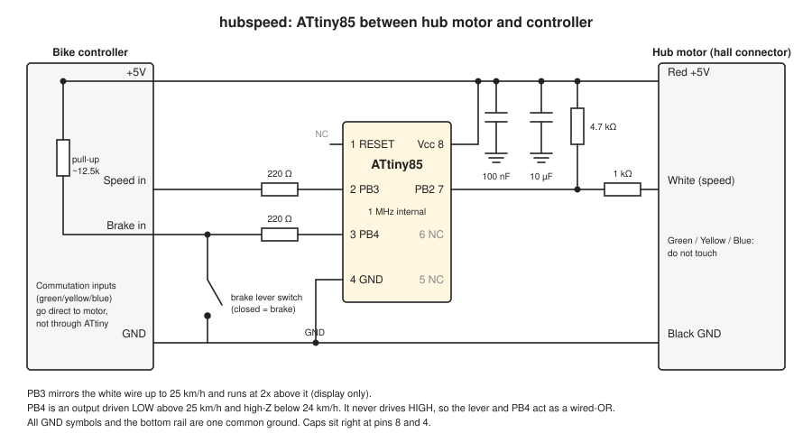
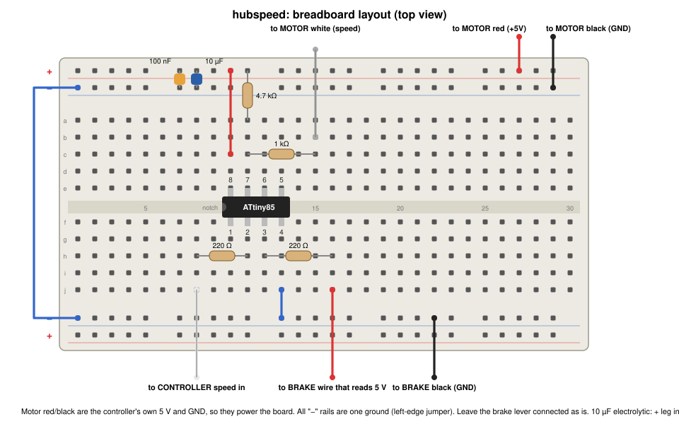
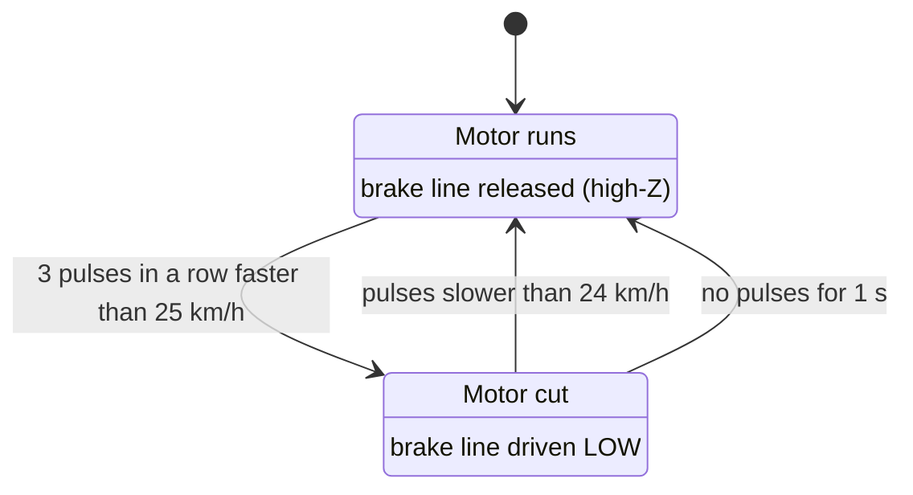

# Bikespeed circuit design

**Version 1.0: released, working version.** The hubspeed firmware described here ([hubspeed/hubspeed.ino](hubspeed/hubspeed.ino)) is the released, working version 1.0. It limits the bike to 25 km/h with a 24 km/h release, uses the noise filter (3 fast pulses in a row), and builds to 678 bytes.

An ATtiny85 limits an e-bike to 25 km/h by pulling the brake sensor line LOW, as if the brake had been pressed. The controller then cuts power to the motor.

The motor's white speed wire is **not** routed through the chip. The motor-side half and the controller-side half are joined together, so the speed reaches the controller and the display exactly as it did before. The ATtiny only **listens** to that wire.

An earlier design put the chip in the speed path, mirrored the pulses and doubled them above 25 km/h so that the display showed double the speed. The display did double, but the controller works out its own speed from the commutation halls (green, yellow, blue), so it ignored the doubled white wire and the motor kept running. The brake line is what stops the motor. Once the brake line was doing the work, the speed path no longer needed to go through the chip, so it was removed.

Firmware: [hubspeed/hubspeed.ino](hubspeed/hubspeed.ino) (678 bytes). Build and flash: [hubspeed/build_and_flash.sh](hubspeed/build_and_flash.sh).

## Circuit diagram

## Breadboard layout

Build notes for the breadboard:

- The ATtiny85 straddles the centre gap with the notch on the left. Pins 1–4 are on the bottom row (f) in columns 10–13, and pins 5–8 are on the top row (e), with pin 8 over column 10.
- The motor's white wire (yellow lead) and the controller's white wire (green lead) go into the same column strip, column 15. The strip is the join, so the speed signal passes straight through.
- A 1 kΩ resistor runs from column 15 to pin 7 (PB2), so the chip listens to the speed wire.
- Optional: a 100 nF capacitor from the pin 7 strip (column 11) to the top − rail. With the 1 kΩ it filters short noise spikes before they reach the chip.
- Top rails: + (red) and − (blue). The 100 nF and 10 µF capacitors sit directly across them, close to the chip. The 10 µF electrolytic has its + leg in the + rail.
- The bottom − rail is joined to the top − rail by the blue jumper down the left edge, so there is one common ground.
- Pin 4 (GND) goes to the bottom − rail with a short blue jumper.
- Power comes in on the motor red and black leads (the controller's own 5 V and GND).
- The brake lever stays connected as it is. The two brake sensor wires, red (reads 5 V) and black (GND), are spliced in: red goes to the 220 Ω resistor on PB4 and black goes to the ground rail.

## Connections

| ATtiny85 pin | Name | Connects to | Via |
|---|---|---|---|
| 1 | PB5 / RESET | not connected | |
| 2 | PB3 | not connected | |
| 3 | PB4 | Brake sensor wire that reads 5 V, spliced in parallel with the existing lever switch | 220 Ω |
| 4 | GND | Hub connector black, brake sensor black | |
| 5, 6 | PB0, PB1 | not connected | |
| 7 | PB2 | The joined white speed wire (input only) | 1 kΩ, with an optional 100 nF to GND |
| 8 | Vcc | Hub connector red (+5 V) | 100 nF and 10 µF to GND at the chip |

The only parts are the ATtiny85, one 1 kΩ resistor, one 220 Ω resistor, a 100 nF capacitor and a 10 µF capacitor for the supply, and the optional 100 nF capacitor on pin 7.

The green, yellow and blue commutation wires are not touched. Interfering with them can make the motor stutter or damage the controller.

## Behaviour

- Each falling edge on the speed wire is one magnet passing the hall sensor, 6 per wheel turn. The chip times the gap between edges and compares it with two fixed limits.
- A 29 inch wheel is 2.314 m round, so 25 km/h is a pulse every 55 538 µs and 24 km/h is a pulse every 57 852 µs. A shorter gap is faster. The 1 km/h gap between the two limits stops the output chattering.
- With no pulses for 1 s the chip lets go of the brake line.
- **Noise.** At high motor power the speed wire picks up spikes. A real pulse is LOW for several milliseconds, so anything LOW for under 1.5 ms is ignored, pulses closer than 10 ms are ignored, and the brake is only applied after 3 fast pulses in a row. One stray pulse therefore cannot apply the brake. In a simulation of this logic, noise that caused 14 to 229 false brake applications a minute with the earlier logic caused none (narrow spikes and spikes inside real pulses) or 1 to 6 (wide 3 ms spikes).
- With the cutoff active the bike coasts below 24 km/h and power comes back. The result is a pulsing cap at about 24–25 km/h.
- If the chip fails or loses power, PB4 floats, the speed wire is still joined, and the bike behaves as it did before.

## Brake-cutoff line

Measured on the bike's brake sensor wires:

- About 5 V across them with nothing connected (open circuit).
- About 0.4 mA through a meter connected across them (short circuit).

That means the controller pulls the line up through about 12.5 kΩ (5 V ÷ 0.4 mA), and the brake lever shorts it to ground. The input is active LOW.

| State | PB4 | Line level | Controller sees |
|---|---|---|---|
| Normal | Input (high-Z) | About 5 V | No brake |
| Cutoff | Output, LOW | About 0 V | Brake applied, motor power cut |

PB4 never drives HIGH, so it cannot fight the real brake lever. The 0.4 mA is well within what the ATtiny pin can sink, so no transistor is needed.

## Power

The ATtiny runs from the hub connector's red and black wires. These are the controller's own 5 V and GND carried down the motor cable.

- It draws about 1–2 mA at 1 MHz.
- Motor PWM puts ripple on the 5 V rail, so fit the 100 nF and 10 µF capacitors right at the chip with short leads.
- If the rail dips by more than about 100 mV while the motor runs, add a small LC filter (10 µH and 10 µF) on the red feed.

## Bench checks before riding

1. Bike on a stand with the wheel off the ground.
2. The display shows the true speed as the wheel spins, because the speed wire is joined straight through.
3. Brake line reads about 5 V below 24 km/h and about 0 V above 25 km/h, and the motor cuts and returns.
4. The ATtiny's 5 V rail (pin 8) stays steady while the motor runs.

## Build and upload

Toolchain notes for the Apple Silicon workaround are in the project memory. Programmer: FabISP (USBtiny). From the `hubspeed` folder, run `./build_and_flash.sh flash`.

The script builds `hubspeed.ino` as plain C++. For an `.ino` file, the Arduino build generates function prototypes with ctags, and on this Mac that step dropped the return types and inserted `setup();` and `loop();` calls into the interrupt handler. The script also checks that the compiled interrupt handler calls only `micros`, and refuses to flash if it calls anything else.
